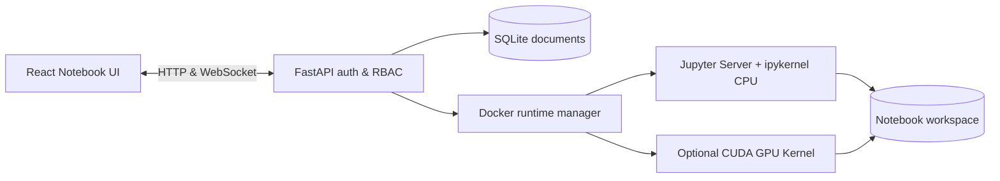

# Nebula Notebook — Self-Hosted Jupyter Notebook with CPU/GPU Runtimes

[](https://github.com/1998x-stack/Nebula-Notebook/actions/workflows/ci.yml)
[](LICENSE)
[](SECURITY.md)

**Nebula Notebook is an open-source, self-hosted Python/Jupyter Notebook platform inspired by Google Colab.** It combines a React notebook editor, FastAPI API, a real IPython kernel, Docker-isolated CPU execution, and optional NVIDIA GPU support validated by an in-container PyTorch CUDA check. It supports `.ipynb` import/export and owner/editor/viewer permissions.

**[中文说明](README.zh-CN.md) · [Install](#quick-start) · [Deployment](docs/DEPLOYMENT.md) · [Architecture](docs/ARCHITECTURE.md) · [FAQ](docs/FAQ.md) · [Security](SECURITY.md) · [Contribute](CONTRIBUTING.md)**

> **Beta / trusted-user deployment only.** This project's code execution is **not hardened for arbitrary untrusted internet users**. Docker grants significant host privileges to its operator; GPU passthrough introduces additional risk. See the [security policy](SECURITY.md) before deploying. Real CPU/GPU end-to-end validation on target Ubuntu hardware is still required.

## Why Nebula Notebook?

Nebula Notebook is a **Google Colab-style self-hosted alternative** for developers, labs and trusted teams that prefer to use their own Ubuntu machines rather than managed remote GPU services. The browser edits notebook cells; the backend authorizes requests; a Jupyter Server and `ipykernel` running in a dedicated Docker container execute Python. Notebook documents are stored separately from live Kernel state.

## Features and status

| Feature | Implementation | Status |
| --- | --- | --- |
| Python notebook UI | React, CodeMirror, Markdown, cells, output | Implemented |
| Execution | Jupyter Kernel over WebSocket proxy | Implemented; host smoke test required |
| CPU runtimes | Docker per notebook with resource limits | Implemented; host smoke test required |
| NVIDIA GPU | Optional image + real PyTorch CUDA probe | Implemented; compatible GPU host required |
| Users and sharing | Administrator, owner, editor, viewer | Implemented |
| Persistence | SQLite documents, versioned saves, .ipynb import/export | Implemented |
| Workspace | Guarded upload, download and delete | Implemented |
| Collaboration / multi-node / AI | Not in v0.1 | Roadmap |

## Architecture



The **Notebook document** is persistent; **Python memory/variables** normally disappear when the runtime stops. Permissions are enforced by the API and Kernel proxy, not by hiding UI buttons.

## Quick start

Recommended: Ubuntu 22.04/24.04, Python 3.11+, Node.js 22 and npm, Docker Engine. Run as a trusted non-root user with Docker access.

```bash
git clone https://github.com/1998x-stack/Nebula-Notebook.git
cd Nebula-Notebook
./scripts/doctor.sh
cp .env.example .env
nano .env  # Set ADMIN_EMAIL and a strong unique ADMIN_PASSWORD

docker build -f docker/runtime.cpu.Dockerfile -t nebula-runtime:cpu .
cd frontend && npm install && npm run build && cd ..
./scripts/launch.sh
```

Open **http://127.0.0.1:8000** and sign in. To use the instance from another machine, prefer a private SSH tunnel:

```bash
ssh -L 8000:127.0.0.1:8000 user@ubuntu-server
```

Do not publish the API on `0.0.0.0` for untrusted users. [Full deployment instructions](docs/DEPLOYMENT.md).

### Optional NVIDIA GPU

On the **Ubuntu backend host**, install compatible NVIDIA drivers and NVIDIA Container Toolkit before building the GPU image:

```bash
docker build -f docker/runtime.gpu.Dockerfile -t nebula-runtime:gpu .
./scripts/check_gpu.sh
```

The frontend offers GPU **only when PyTorch can use CUDA inside the configured Docker image**. If verification fails, CPU remains the baseline. The browser computer's GPU does not count.

## Verify your setup

```bash
cd backend
python3 -m venv .venv && .venv/bin/pip install -r requirements.txt
PYTHONPATH=. .venv/bin/pytest -q
cd ../frontend && npm install && npm run build && cd ..
NEBULA_SMOKE_EMAIL=admin@example.com NEBULA_SMOKE_PASSWORD='your-password' \
  backend/.venv/bin/python scripts/smoke.py
```

The smoke test requires a running backend and built CPU image. CI **does not prove GPU correctness**. See [validation details](VALIDATION_REPORT.md).

## Nebula vs Colab vs JupyterLab

| | Nebula Notebook v0.1 | Google Colab | JupyterLab |
| --- | --- | --- | --- |
| Hosting | Your own server | Cloud-managed | Configurable/self-hosted |
| Compute | Docker CPU; optional local NVIDIA GPU | Cloud CPU/GPU/TPU, eligibility dependent | Kernel/server dependent |
| Files | Jupyter .ipynb | Jupyter .ipynb | Jupyter .ipynb |
| Notebook permissions | Admin/owner/editor/viewer | Provider-managed sharing | Deployment dependent |
| Production untrusted multi-tenancy | **Not supported** | Managed provider | Depends on architecture |

Nebula Notebook is **not affiliated with or endorsed by Google or Project Jupyter**. Details: [comparison](docs/COMPARISON.md).

## FAQ

**Can I use it without a GPU?** Yes, build the CPU runtime image and run notebooks on your Ubuntu host.

**Can I import a Google Colab or Jupyter notebook?** Yes, standard `.ipynb` import/export is supported. Not all widget extensions are implemented.

**Can multiple users share a notebook?** Yes, admins provision accounts and notebook owners grant viewer/editor access to trusted collaborators. Editors can execute Python.

**Is it suitable for anonymous internet visitors?** **No.** This beta has not been hardened for hostile multi-tenancy.

Find more answers in [FAQ](docs/FAQ.md).

## Community

- [Issues and feature requests](https://github.com/1998x-stack/Nebula-Notebook/issues)
- [Contribution guide](CONTRIBUTING.md)
- [Security policy](SECURITY.md)
- [Changelog](CHANGELOG.md)
- [Discoverability and GEO/SEO](docs/DISCOVERABILITY.md)
- [Machine-readable documentation index](llms.txt)

**License:** [MIT](LICENSE) · Maintained at [1998x-stack](https://github.com/1998x-stack).
