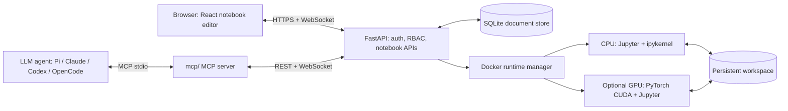

# Nebula Notebook — Agent-Native, Self-Hosted Jupyter Notebook with MCP and CPU/GPU Runtimes

[](https://github.com/1998x-stack/Nebula-Notebook/actions/workflows/ci.yml)
[](LICENSE)
[](backend/requirements.txt)
[](SECURITY.md)

**An agent-native computational notebook where humans and AI agents can build, execute, observe, and reproduce research together.** Nebula Notebook is an open-source, self-hosted Jupyter notebook workspace for humans and coding agents including Pi, OpenCode, Claude and Codex. It is independently developed and inspired by interactive notebook workflows such as Google Colab and Jupyter. Run `.ipynb` notebooks in your browser with a React editor, a real IPython kernel, Docker-managed CPU runtimes, and optional NVIDIA GPU execution verified inside the container. Notebook sharing uses owner, editor, and viewer roles.

**[中文文档](README.zh-CN.md)** · **[Quick start](#quick-start)** · **[Architecture](docs/ARCHITECTURE.md)** · **[Deployment](docs/DEPLOYMENT.md)** · **[FAQ](docs/FAQ.md)** · **[Security](SECURITY.md)** · **[Contributing](CONTRIBUTING.md)**

> **Beta / trust model:** Intended for personal machines, labs, and **trusted collaborators**. This is **not yet safe as a public, arbitrary-code-execution service for untrusted internet users**. Docker access is security-sensitive; see [Security & threat model](SECURITY.md). Frontend UI, API, and unit tests are included, but complete real-world deployment and GPU tests still need to be run on your own hardware. [Validation details](VALIDATION_REPORT.md).

## What is Nebula Notebook?

Nebula Notebook is a web-based Python notebook server that lets you create, run, import, export, and share Jupyter-compatible `.ipynb` documents without sending your code to a third-party hosted notebook service. Your own **Ubuntu host** supplies CPU/GPU resources. The browser edits notebooks; a FastAPI server authorizes actions; a Jupyter Server + `ipykernel` in a per-notebook Docker container executes Python. GPU is offered **only when a real PyTorch CUDA check succeeds inside the configured GPU image**.

### Features

| Feature | Implementation | Current status |
| --- | --- | --- |
| Notebook editor | React, CodeMirror, Markdown and cell reordering | Implemented |
| Notebook URLs | `/notebook/<id>` deep links with refresh and history navigation | Implemented |
| Python execution | Jupyter kernel messages over an authorized WebSocket proxy | Implemented; host smoke test required |
| CPU sessions | Per-notebook Docker runtime with resource limits | Implemented; host smoke test required |
| NVIDIA GPU | Optional CUDA image and PyTorch-in-container availability probe | Implemented; requires supported host |
| Access control | Admin, notebook owner, editor, viewer | Implemented |
| Shared notebooks | Registered users collaborate on one Notebook using owner/editor/viewer roles; "Shared with me" view | Implemented for trusted teams |
| Immutable versions & private forks | Saved revisions, history browsing, fork an available version to private ownership | Implemented; pre-upgrade versions cannot be recovered |
| Save & export | Compare-and-swap SQLite document saves, `.ipynb` import/export | Implemented |
| Workspace files | Upload/download/delete with guarded flat filenames | Implemented |
| Agent integration (MCP) | 54-tool stdio MCP server for Pi, Claude, Codex and OpenCode | Implemented |
| Single-host operations | Ubuntu doctor, launch, smoke scripts and CI | Implemented |
| Live notebook events | Durable SSE document events, reconnection cursor, incremental Cell updates | Implemented; production load validation pending |
| Managed Agent output streaming | Batch stdout/stderr/display in live SSE while run_submit is executing | Implemented; real Kernel smoke pending |
| Multi-node scheduling / CRDT co-typing / SSO | Not in v0.1 | Roadmap |

### Shared research workspaces and independent versioned forks

Nebula supports **one canonical Notebook shared with several registered users**.
A creator can grant viewer or editor access by email. Each user — and each
user's Pi, Claude, OpenCode or Codex agent — authenticates with their **own
Nebula account**, so all actions pass the same API/Kernel RBAC checks.

- **Personal workspace:** Your own notebooks and folders; new notebooks start
  private. The dashboard has a single **New notebook** button.
- **Shared with me:** Notebooks owned by others and shared with your account.
  The owner's private folder ID is never shown to collaborators.
- **Shared original:** Editors change the same document ID. Concurrent writes
  require the expected version and return HTTP 409 instead of overwriting.
  Shared editor execution uses the source notebook's common Kernel/workspace.
- **Private fork:** A reader, editor or owner can select an *available saved
  version* and create an independent Notebook with a new ID, personal history,
  separate runtime/workspace and **no inherited grants**. Code/output are
  copied, but not RAM or dataset files. Revoking source access does not erase
  already-created independent forks.
- **Immutable history:** Each successful save or managed job's committed output
  creates a version snapshot. When upgrading an older installation, only its
  current state can be backfilled; no unknown historical content is invented.

The frontend exposes **History / Fork** and the same operations are available
through MCP: `notebook_versions`, `notebook_version`, `notebook_fork`.
This is **versioned collaboration**, not conflict-free simultaneous co-typing,
automatic branching/merging or a public multi-tenant execution sandbox.

**[Data model, permission matrix, collaboration trade-offs and rollout design →](docs/SHARED_COLLABORATION.md)**

### System architecture



The **notebook document** is persisted separately from the **live Python kernel state**. Stopping a runtime removes in-memory variables but does not delete saved documents or the persistent workspace. [Architecture details →](docs/ARCHITECTURE.md)

## Quick start

Tested prerequisites are **not verified on every machine**. Recommended: Ubuntu 22.04/24.04, Python 3.11+, Node.js 22, npm, Docker Engine with permission to manage local containers. GPU is optional and requires an NVIDIA driver and NVIDIA Container Toolkit. **Run as a non-root account.**

```bash
# 1. Clone
git clone https://github.com/1998x-stack/Nebula-Notebook.git
cd Nebula-Notebook

# 2. Check host and configure secrets
./scripts/doctor.sh
cp .env.example .env
nano .env  # Set ADMIN_EMAIL, a unique ADMIN_PASSWORD (12+ chars)

# 3. Build Python CPU kernel image
docker build -f docker/runtime.cpu.Dockerfile -t nebula-runtime:cpu .

# 4. Build browser UI
cd frontend && npm install && npm run build && cd ..

# 5. Launch API and bundled frontend (one worker)
./scripts/launch.sh
```

Open **http://127.0.0.1:8000** and sign in with your configured administrator credentials. Create a notebook, choose **CPU**, connect, and run `print('Hello, Nebula!')`. To access from another computer, start with an SSH tunnel; do **not** directly publish port 8000 to the internet.

```bash
# Run on your own computer, replacing user@server with an SSH destination
ssh -L 8000:127.0.0.1:8000 user@server
```

### Optional NVIDIA GPU

```bash
# Only on hosts with compatible NVIDIA drivers and NVIDIA Container Toolkit
docker build -f docker/runtime.gpu.Dockerfile -t nebula-runtime:gpu .
./scripts/check_gpu.sh
```

The GPU option is enabled only if the server can start the GPU Docker image and execute `torch.cuda.is_available() == True`. GPU hardware in the **browser/client** does not count. If GPU verification fails, the CPU path remains available. [GPU troubleshooting →](docs/DEPLOYMENT.md#gpu-setup-and-verification)

### Screenshots and demo (contributions welcome)

Proposed visual assets (intentionally shown as text until screenshots exist; no broken image links):

| Visual | Suggested filename | What it should show |
| --- | --- | --- |
| Notebook editor | `docs/assets/notebook-editor.webp` | Code + Markdown + inline plot in the browser |
| Shared research | `docs/assets/shared-notebooks.webp` | Sidebar Shared with me, collaborator roles and History / Fork dialog |
| Agent workflow | `docs/assets/agent-live-sync.gif` | Capture Agent MCP Cell add/move/delete and durable `run_submit` streamed output in one browser |
| Variable inspector | `docs/assets/variables-inspector.webp` | Variable names, shapes and types without huge values |
| Autoresearch trials | `docs/assets/research-results.webp` | **Planned:** trial metric comparison and provenance |

<!-- SCREENSHOT TODO (do not add broken links before assets exist):
1. docs/assets/notebook-editor.png — Desktop notebook editor with code, Markdown and chart output; alt="Nebula Notebook web editor running Python cells"
2. docs/assets/agent-live-sync.gif — Pi agent adds, moves and runs cells while browser renders changes; alt="Agent-driven notebook execution and live output"
3. docs/assets/variables-inspector.png — MCP kernel variable metadata (type, shape, dtype, device); alt="MCP notebook variable inspector"
4. docs/assets/research-results.png — Reproducible experiment comparison and metric chart; alt="Notebook autoresearch experiment tracking"
Capture at 1440x900 or similar; use anonymized demo notebooks. Optimize screenshots (<300 KB WebP where possible); 8–15s GIF may be converted to MP4 for documentation performance.
These illustrate current and proposed features; do not depict proposed features as shipped.
-->

### Run-backed, reproducible Agent experiments (P1-A)

The **Agent research ledger** links each bounded Trial to a real managed Run
and an immutable Notebook source version. Freeze an evaluator Cell's source
hash, primary metric/direction, asserted dataset + environment SHA-256 hashes,
CPU/GPU mode and trial budget. A score is recorded only after the candidate
and unchanged evaluator Runs **actually succeeded**. Nebula ranks verified
metrics, retains candidate-version Checkpoints and stores immutable SHA-256
Artifacts up to 8 MB. Pi, Claude, Codex and OpenCode access these through nine
`research_*` MCP tools and `examples/autoresearch-prompt.txt`.

**Current boundary:** data/environment hashes are operator assertions, not
independently attested container/dataset snapshots; candidate Python shares a
mutable Kernel with evaluation. This is an auditable, finite experiment ledger,
**not** hermetic evaluation, automatic GPU optimization or a reproduction of
upstream autoresearch's reported results.

[Research engine, protocol and examples →](docs/RESEARCH_ENGINE.md).

### Durable history, backup and event replay recovery (P0-F)

P0-F introduces **versioned SQLite migrations**, per-Notebook SSE retention
floors with explicit `stream_reset` recovery, and operator-controlled
**offline backup / SHA-256 verification / empty-directory restore**. The browser
reloads the authoritative Notebook if its replay cursor was pruned, while
keeping any unsaved draft available for P0-E conflict resolution.

Historical Notebook revisions are **not pruned automatically**: any retained
version can still be Forked or used as a three-way merge base. Event compaction
is manual and disabled by default. Large-Artifact object storage, snapshot
compression and hosted multi-tenant quotas are still outstanding.

[Storage reliability, backup and restoration runbook →](docs/STORAGE_RELIABILITY.md).

### Recoverable shared editing and explicit three-way merges (P0-E)

If a human or MCP Agent edits an older Notebook version while another
collaborator saves, Nebula now supports **base / mine / latest** Cell-level
merge preview instead of forcing a full reload. Independent Cell changes are
combined; competing edits to the same Cell, deletion versus modification
and incompatible Cell moves require an explicit `mine` / `theirs` choice.
The browser keeps unsaved code safe on HTTP 409, and an editor can
**save the draft as a private Fork** without changing the shared Notebook.

Merge commit uses an exact latest-version CAS, a stable idempotent operation
ID, immutable history, and the existing live SSE stream. Pi, OpenCode,
Claude and Codex can use MCP `notebook_merge_preview`,
`notebook_merge_commit` and `notebook_fork_draft`.

[Three-way merge design and acceptance →](docs/COLLABORATION_MERGE.md).

### Execution lifecycle reliability (P0-D)

Nebula now commits durable Run terminal state and `run.finished` SSE events
**atomically**, including `interrupted` recovery after a server restart.
Jupyter execution waits for both shell `execute_reply` and IOPub `idle`
even if they arrive out of order. Kernel startup/handshake failures do not
create false `uncertain` locks; after an attempted execution whose outcome
cannot be confirmed, the gate stays locked until intentional Runtime stop.

Editors can inspect `GET /api/notebooks/{id}/execution-state` for gate state,
active jobs, required recovery and an opaque Kernel generation fingerprint
(without exposing container IDs or secrets). Real Docker CPU arbitration and
opt-in disconnect fault injection are provided by
`scripts/smoke_p0d.py`; hardware acceptance remains outstanding.

[Lifecycle hardening and host acceptance guide →](docs/LIFECYCLE_HARDENING.md).

### Collision-safe multi-Agent operations (P0-C)

Shared editors and MCP Agents can now add, update, move and delete Cells through
one server-authoritative, idempotent API. Each operation carries an
`expected_version` and a stable `operation_id`, produces a durable SSE
event and a forkable revision, and returns **409** on competing changes rather
than silently overwriting another user's work.

The browser's Kernel WebSocket and MCP managed `run_submit` share a
database-backed exclusive execution gate. If the API or Kernel connection
drops before the matching Kernel idle state, the gate becomes **uncertain**;
stopping/restarting that Notebook Runtime intentionally resets it. This
conservative mechanism prevents double dispatch but does not guarantee
exactly-once Python side effects.

[Detailed P0-C protocol and acceptance checklist →](docs/EXECUTION_ARBITRATION.md).

### Live notebook collaboration events (P0-B)

The editor subscribes to `GET /api/notebooks/{id}/events` using a persisted
global event ID, `Last-Event-ID` replay and per-poll RBAC checks. Edits by a
different MCP-connected user are shown as incremental Cell changes. For **live
execution output**, agents should use `run_submit` and track the durable
`run_id`; legacy synchronous `cell_run` still updates the saved document at
the end. No live Kernel variables or rich output beyond bounded display MIME
are broadcast. [Protocol and validation →](docs/LIVE_EVENTS.md).

### Durable code execution for agents

Long-running Python cells can now be submitted through idempotent HTTP/MCP execution
runs (`run_submit`, `run_status`, `run_wait`, `run_cancel`). The run
record survives client disconnections; restarts mark in-progress work as
`interrupted` rather than replaying effects. This is a single-worker beta,
not exactly-once Python execution. See [Execution runs](docs/EXECUTION_RUNS.md).

### Use Nebula from an LLM agent (MCP)

`mcp/` exposes the notebook API as a stdio MCP server with **54 tools and 2 resources**: create/import/export notebooks, organise them into folders, insert/update/delete/move cells, run cells and save outputs, `code_execute`, runtime start/stop/interrupt/diagnostics, workspace read/write at any depth, sharing and admin operations. It authenticates through the normal session/CSRF/RBAC API, so it does not add a new trust boundary.

```bash
./mcp/install-pi.sh      # register in ~/.pi/agent/mcp.json
pi mcp list              # connected, 54 tools
# Claude Desktop, Codex CLI and OpenCode configs: mcp/README.md
mcp/.venv/bin/python mcp/test_mcp.py
```

Saved Notebook changes from another Agent are delivered over a single authenticated, replayable **SSE stream** with Cell-level deltas; version polling is a fallback. A managed `run_submit` shows running state and bounded stdout/stderr/display batches as the Kernel executes (rather than waiting for final document save). Hidden tabs close the live stream and resynchronize when reopened; this is not a CRDT editor. See [P0-B live events](docs/LIVE_EVENTS.md). Agent-facing extensions include `kernel_variables` (bounded metadata-only inspection of live Python objects); this requires execution permission and does not auto-start a runtime. For a practical workflow, see [Agent setup for Pi, OpenCode, Claude and Codex](docs/AGENT_SETUP.md), the [autoresearch prompt](examples/autoresearch-prompt.txt), [Agent-native roadmap](docs/AGENT_NATIVE_ROADMAP.md), and [multi-kernel design](docs/MULTI_KERNEL.md).

The MCP server is intended for a trusted local agent. Code execution is arbitrary Python in the notebook container; use a dedicated user and keep the API on localhost or a private tunnel. See **[mcp/README.md](mcp/README.md)** for the full tool catalog, workflows, environment variables and security model.

## Validate your installation

```bash
# Backend/API tests
cd backend
python3 -m venv .venv
.venv/bin/pip install -r requirements.txt
PYTHONPATH=. .venv/bin/pytest -q
cd ..

# Frontend build
cd frontend && npm install && npm run build && cd ..

# Smoke test (run with backend started and CPU image built)
NEBULA_SMOKE_EMAIL=admin@example.com NEBULA_SMOKE_PASSWORD='your-real-password'   backend/.venv/bin/python scripts/smoke.py
```

For a fresh install, use [Deployment guide](docs/DEPLOYMENT.md), [FAQ](docs/FAQ.md), and [Validation report](VALIDATION_REPORT.md). Do not treat the CI badge alone as proof of GPU functionality.

## Comparison with Google Colab and JupyterLab

| | Nebula Notebook v0.1 | Google Colab | JupyterLab |
| --- | --- | --- | --- |
| Hosting | Self-hosted | Managed cloud | Primarily self-hosted / deployable |
| Compute | Your Docker host, CPU + optional NVIDIA GPU | Google-managed runtimes, eligibility-dependent accelerators | Configurable server/kernel infrastructure |
| File format | Jupyter `.ipynb` | Jupyter `.ipynb` | Jupyter `.ipynb` |
| Team permissions | Admin + owner/editor/viewer | Platform-specific sharing | Depends on deployment and add-ons |
| Agent integration | MCP stdio server with 54 tools | Product-integrated AI features | MCP / extensions |
| General-purpose multi-tenant safety | Not production-hardened | Managed by provider | Depends on deployment |

Nebula Notebook is an **independent project**, not affiliated with or endorsed by Google or Project Jupyter. “Colab” and “Jupyter” are trademarks of their respective owners. [Read a more detailed comparison →](docs/COMPARISON.md).

## Repository layout

```text
backend/app/           FastAPI auth, RBAC, persistence, Docker runtime & kernel proxy
backend/tests/         API, authorization and file tests
frontend/              React + CodeMirror notebook interface
docker/                CPU and optional NVIDIA CUDA kernel images
scripts/               Host diagnostics, local launch, GPU check, smoke test
mcp/                   Stdio MCP server, client configs and acceptance test
docs/                  Architecture, deployment, FAQ, comparison
examples/              Sample Jupyter notebook
.github/               CI, issue and PR templates
```

## Frequently asked questions

**Can I run Nebula Notebook without a GPU?** Yes. CPU mode is the baseline; GPU is optional and verified on the Ubuntu host.

**Does Nebula Notebook support existing Jupyter notebooks?** Yes. Import/export the `.ipynb` format; compatibility varies for extensions and interactive widgets (widgets are not included in v0.1).

**Is this a hosted Google Colab replacement?** No. It is a **self-hosted** notebook server using your own hardware, not a hosted computing service.

**Can I expose it publicly?** Not to arbitrary users in this beta. Use localhost or a private tunnel for trusted collaborators. See the [security model](SECURITY.md).

**Can multiple users execute code?** Yes, administrators can provision users and notebook owners can grant trusted editors execution permissions. That permission permits running Python against the shared notebook workspace.

More answers: [Full FAQ](docs/FAQ.md).

## Community and project governance

- Bugs, feature proposals, usage questions: [GitHub Issues](https://github.com/1998x-stack/Nebula-Notebook/issues)
- Changes: [Contribution guide](CONTRIBUTING.md) · [Code of Conduct](CODE_OF_CONDUCT.md)
- Responsible reporting: [Security policy](SECURITY.md)
- Releases and changes: [Changelog](CHANGELOG.md)
- Support scope: [Support guide](SUPPORT.md)

**License:** [MIT](LICENSE). Third-party packages have their own licenses. Maintained by the [1998x-stack GitHub community](https://github.com/1998x-stack).
