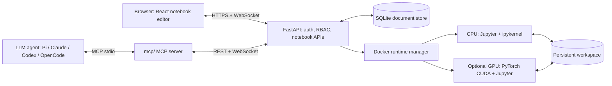

# Nebula Notebook — Self-Hosted Jupyter Notebook with CPU/GPU Runtimes

[](https://github.com/1998x-stack/Nebula-Notebook/actions/workflows/ci.yml)
[](LICENSE)
[](backend/requirements.txt)
[](SECURITY.md)

**Nebula Notebook is an open-source, self-hosted alternative to cloud-hosted Python notebooks inspired by Google Colab and Jupyter.** Run `.ipynb` notebooks in your browser with a React editor, a real IPython kernel, Docker-managed CPU runtimes, and optional NVIDIA GPU execution verified inside the container. Notebook sharing uses owner, editor, and viewer roles.

**[中文文档](README.zh-CN.md)** · **[Quick start](#quick-start)** · **[Architecture](docs/ARCHITECTURE.md)** · **[Deployment](docs/DEPLOYMENT.md)** · **[FAQ](docs/FAQ.md)** · **[Security](SECURITY.md)** · **[Contributing](CONTRIBUTING.md)**

> **Beta / trust model:** Intended for personal machines, labs, and **trusted collaborators**. This is **not yet safe as a public, arbitrary-code-execution service for untrusted internet users**. Docker access is security-sensitive; see [Security & threat model](SECURITY.md). Frontend UI, API, and unit tests are included, but complete real-world deployment and GPU tests still need to be run on your own hardware. [Validation details](VALIDATION_REPORT.md).

## What is Nebula Notebook?

Nebula Notebook is a web-based Python notebook server that lets you create, run, import, export, and share Jupyter-compatible `.ipynb` documents without sending your code to a third-party hosted notebook service. Your own **Ubuntu host** supplies CPU/GPU resources. The browser edits notebooks; a FastAPI server authorizes actions; a Jupyter Server + `ipykernel` in a per-notebook Docker container executes Python. GPU is offered **only when a real PyTorch CUDA check succeeds inside the configured GPU image**.

### Features

| Feature | Implementation | Current status |
| --- | --- | --- |
| Notebook editor | React, CodeMirror, Markdown and cell reordering | Implemented |
| Notebook URLs | `/notebook/<id>` deep links with refresh and history navigation | Implemented |
| Python execution | Jupyter kernel messages over an authorized WebSocket proxy | Implemented; host smoke test required |
| CPU sessions | Per-notebook Docker runtime with resource limits | Implemented; host smoke test required |
| NVIDIA GPU | Optional CUDA image and PyTorch-in-container availability probe | Implemented; requires supported host |
| Access control | Admin, notebook owner, editor, viewer | Implemented |
| Save and share | SQLite documents, versioned writes, `.ipynb` import/export | Implemented |
| Workspace files | Upload/download/delete with guarded flat filenames | Implemented |
| Agent integration (MCP) | 35-tool stdio MCP server for Pi, Claude, Codex and OpenCode | Implemented |
| Single-host operations | Ubuntu doctor, launch, smoke scripts and CI | Implemented |
| Multi-node scheduling / live co-editing / SSO | Not in v0.1 | Roadmap |

### System architecture



The **notebook document** is persisted separately from the **live Python kernel state**. Stopping a runtime removes in-memory variables but does not delete saved documents or the persistent workspace. [Architecture details →](docs/ARCHITECTURE.md)

## Quick start

Tested prerequisites are **not verified on every machine**. Recommended: Ubuntu 22.04/24.04, Python 3.11+, Node.js 22, npm, Docker Engine with permission to manage local containers. GPU is optional and requires an NVIDIA driver and NVIDIA Container Toolkit. **Run as a non-root account.**

```bash
# 1. Clone
git clone https://github.com/1998x-stack/Nebula-Notebook.git
cd Nebula-Notebook

# 2. Check host and configure secrets
./scripts/doctor.sh
cp .env.example .env
nano .env  # Set ADMIN_EMAIL, a unique ADMIN_PASSWORD (12+ chars)

# 3. Build Python CPU kernel image
docker build -f docker/runtime.cpu.Dockerfile -t nebula-runtime:cpu .

# 4. Build browser UI
cd frontend && npm install && npm run build && cd ..

# 5. Launch API and bundled frontend (one worker)
./scripts/launch.sh
```

Open **http://127.0.0.1:8000** and sign in with your configured administrator credentials. Create a notebook, choose **CPU**, connect, and run `print('Hello, Nebula!')`. To access from another computer, start with an SSH tunnel; do **not** directly publish port 8000 to the internet.

```bash
# Run on your own computer, replacing user@server with an SSH destination
ssh -L 8000:127.0.0.1:8000 user@server
```

### Optional NVIDIA GPU

```bash
# Only on hosts with compatible NVIDIA drivers and NVIDIA Container Toolkit
docker build -f docker/runtime.gpu.Dockerfile -t nebula-runtime:gpu .
./scripts/check_gpu.sh
```

The GPU option is enabled only if the server can start the GPU Docker image and execute `torch.cuda.is_available() == True`. GPU hardware in the **browser/client** does not count. If GPU verification fails, the CPU path remains available. [GPU troubleshooting →](docs/DEPLOYMENT.md#gpu-setup-and-verification)

### Use Nebula from an LLM agent (MCP)

`mcp/` exposes the notebook API as a stdio MCP server with **35 tools and 2 resources**: create/import/export notebooks, insert/update/delete/move cells, run cells and save outputs, `code_execute`, runtime start/stop/interrupt, workspace upload/download/delete, sharing and admin operations. It authenticates through the normal session/CSRF/RBAC API, so it does not add a new trust boundary.

```bash
./mcp/install-pi.sh      # register in ~/.pi/agent/mcp.json
pi mcp list              # connected, 35 tools
# Claude Desktop, Codex CLI and OpenCode configs: mcp/README.md
mcp/.venv/bin/python mcp/test_mcp.py
```

The MCP server is intended for a trusted local agent. Code execution is arbitrary Python in the notebook container; use a dedicated user and keep the API on localhost or a private tunnel. See **[mcp/README.md](mcp/README.md)** for the full tool catalog, workflows, environment variables and security model.

## Validate your installation

```bash
# Backend/API tests
cd backend
python3 -m venv .venv
.venv/bin/pip install -r requirements.txt
PYTHONPATH=. .venv/bin/pytest -q
cd ..

# Frontend build
cd frontend && npm install && npm run build && cd ..

# Smoke test (run with backend started and CPU image built)
NEBULA_SMOKE_EMAIL=admin@example.com NEBULA_SMOKE_PASSWORD='your-real-password'   backend/.venv/bin/python scripts/smoke.py
```

For a fresh install, use [Deployment guide](docs/DEPLOYMENT.md), [FAQ](docs/FAQ.md), and [Validation report](VALIDATION_REPORT.md). Do not treat the CI badge alone as proof of GPU functionality.

## Comparison with Google Colab and JupyterLab

| | Nebula Notebook v0.1 | Google Colab | JupyterLab |
| --- | --- | --- | --- |
| Hosting | Self-hosted | Managed cloud | Primarily self-hosted / deployable |
| Compute | Your Docker host, CPU + optional NVIDIA GPU | Google-managed runtimes, eligibility-dependent accelerators | Configurable server/kernel infrastructure |
| File format | Jupyter `.ipynb` | Jupyter `.ipynb` | Jupyter `.ipynb` |
| Team permissions | Admin + owner/editor/viewer | Platform-specific sharing | Depends on deployment and add-ons |
| Agent integration | MCP stdio server with 35 tools | Product-integrated AI features | MCP / extensions |
| General-purpose multi-tenant safety | Not production-hardened | Managed by provider | Depends on deployment |

Nebula Notebook is an **independent project**, not affiliated with or endorsed by Google or Project Jupyter. “Colab” and “Jupyter” are trademarks of their respective owners. [Read a more detailed comparison →](docs/COMPARISON.md).

## Repository layout

```text
backend/app/           FastAPI auth, RBAC, persistence, Docker runtime & kernel proxy
backend/tests/         API, authorization and file tests
frontend/              React + CodeMirror notebook interface
docker/                CPU and optional NVIDIA CUDA kernel images
scripts/               Host diagnostics, local launch, GPU check, smoke test
mcp/                   Stdio MCP server, client configs and acceptance test
docs/                  Architecture, deployment, FAQ, comparison
examples/              Sample Jupyter notebook
.github/               CI, issue and PR templates
```

## Frequently asked questions

**Can I run Nebula Notebook without a GPU?** Yes. CPU mode is the baseline; GPU is optional and verified on the Ubuntu host.

**Does Nebula Notebook support existing Jupyter notebooks?** Yes. Import/export the `.ipynb` format; compatibility varies for extensions and interactive widgets (widgets are not included in v0.1).

**Is this a hosted Google Colab replacement?** No. It is a **self-hosted** notebook server using your own hardware, not a hosted computing service.

**Can I expose it publicly?** Not to arbitrary users in this beta. Use localhost or a private tunnel for trusted collaborators. See the [security model](SECURITY.md).

**Can multiple users execute code?** Yes, administrators can provision users and notebook owners can grant trusted editors execution permissions. That permission permits running Python against the shared notebook workspace.

More answers: [Full FAQ](docs/FAQ.md).

## Community and project governance

- Bugs, feature proposals, usage questions: [GitHub Issues](https://github.com/1998x-stack/Nebula-Notebook/issues)
- Changes: [Contribution guide](CONTRIBUTING.md) · [Code of Conduct](CODE_OF_CONDUCT.md)
- Responsible reporting: [Security policy](SECURITY.md)
- Releases and changes: [Changelog](CHANGELOG.md)
- Support scope: [Support guide](SUPPORT.md)

**License:** [MIT](LICENSE). Third-party packages have their own licenses. Maintained by the [1998x-stack GitHub community](https://github.com/1998x-stack).
