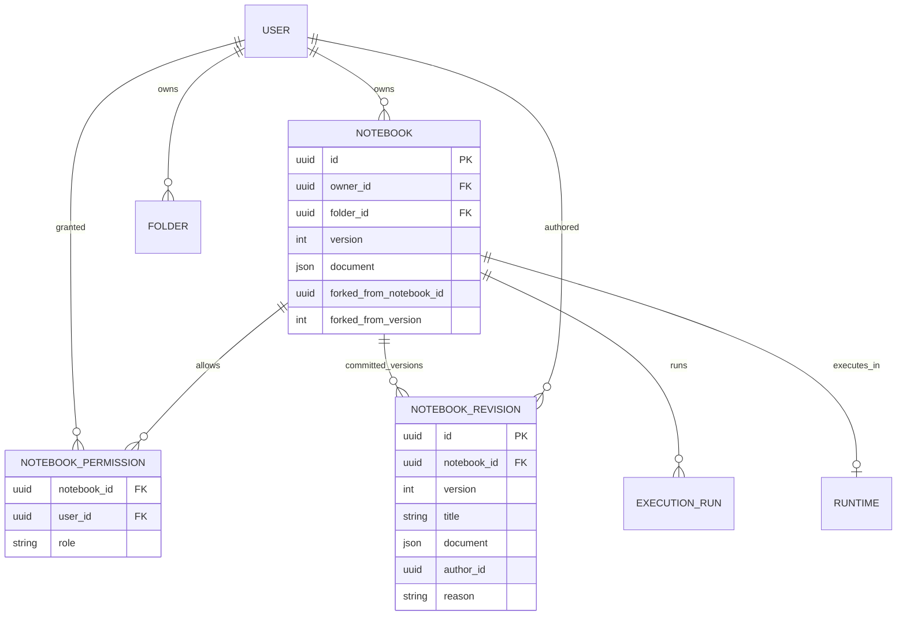

# Nebula Notebook: multi-account shared research and versioned forks

**Status:** collaborative document snapshots, private forks and account-scoped
MCP operations are implemented in this change. True joint ownership,
automatic merge, branch promotion, CRDT and multi-process execution are NOT shipped.

## Product semantics

There are **two distinct operations**:

1. **Share the original:** The owner grants several *registered users* viewer
   or editor access to one canonical Notebook ID. Everyone sees and edits the
   same saved version and outputs. Each user, including each MCP stdio process,
   logs in using personal credentials. Shared Notebook editing is optimistic:
   `PUT` must carry the exact current version, otherwise HTTP 409.
2. **Fork any retained revision:** Any current reader (even viewer) can select
   an immutable saved version and create a **new private Notebook** they own.
   Version history and future edits evolve separately. Runtime and data files
   are NOT copied. A private Fork is not the original, and it does not inherit
   ACLs or automatically merge upstream edits.

For existing deployments without historic storage, only the current version
is recorded during migration; earlier content was never stored and cannot be
recovered. A snapshot is taken on create, import, save and managed execution
result commit. Legacy raw WebSocket output persists through existing
Notebook autosave, which also creates a revision.

## Current database relations

`notebook_revisions(notebook_id, version)` is unique. Version is a
monotonic integer of a **single canonical notebook**, not a revision ID shared
between forks. Each revision stores the original .ipynb document and title
for reproducibility. An individual can own many forks of a shared ancestor.
The lineage fields are informational IDs (not cascade-delete FKs) so that
deleting the source Notebook does not destroy the fork's provenance.

Only folder owner can manipulate folders. A shared recipient sees
`folder_id=null` and `is_shared=true` in their API listing, avoiding
leakage of the owner's private folder structure.

## Authorization and privacy

| Operation | Owner | Editor | Viewer | Unshared user |
| --- | --- | --- | --- | --- |
| Open current or historic Notebook | Yes | Yes | Yes | No |
| Edit original / append a new revision | Yes | Yes | No | No |
| Run original Kernel / edit workspace files | Yes | Yes | No | No |
| Fork retained revision into own private space | Yes | Yes | Yes | No |
| Manage original grants / delete source | Yes | No | No | No |
| Edit, share or delete personal fork | Fork owner only (and admin per current policy) | No inherited access | No inherited access | No |

The existing global admin bypass remains a *beta deployment policy*.
Applications requiring mutually untrusted tenant separation must replace it
with scoped organization/workspace administration. Sharing a Notebook editor
role is privileged: the user can execute Python and inspect its shared
persistent files. Viewers may already export Notebook source/output; Fork
does not disclose more than the viewer could read, but it allows independent
retention after source access is revoked. Avoid saving credentials in cells
or outputs. Per-user credentials are required for MCP.

## API and MCP contracts

- `GET /api/notebooks`: `role`, `owner_id`, `is_shared`, scoped
  `folder_id` (a source owner's private folder is not disclosed).
- `GET /api/notebooks/{id}/versions?limit=50&before=V`: bounded history
  metadata, latest-first; `before` is exclusive.
- `GET /api/notebooks/{id}/versions/{V}`: immutable .ipynb and title.
- `POST /api/notebooks/{id}/fork` with
  `{"version": V, "title": "optional", "folder_id": "optional"}`:
  creates private Notebook with `version=1`, owner=current account,
  private folder ID only if owned by current user, new run state.
- MCP: `notebook_versions`, `notebook_version`, `notebook_fork`;
  CRUD, Cell, Run and Workspace calls continue to use backend RBAC.

Fork is deliberately a user-driven operation; it will not silently overwrite
another collaborator's shared original.

## Rollout and migration

1. Back up the SQLite database and persistent workspaces before upgrade.
2. On startup `create_all` creates `notebook_revisions`. SQLite schema
   migration adds fork lineage columns to older `notebooks`.
3. For every existing Notebook missing a snapshot of its *current* version,
   insert one `reason=backfill` snapshot (not a made-up full history).
4. New Notebook/import/fork creates version 1 snapshot. All successful
   document updates and managed run saves create version N+1 snapshot inside
   the same database transaction as the CAS update.
5. Delete of a source Notebook removes its ACL, runs and stored revisions;
   existing forks remain independent. Its old shared Runtime/workspace files
   have a separate retention policy in the current beta.

The current SQLite implementation stores **full JSON snapshots**. For a
multi-user professional deployment, add history retention quotas, backup and
restore, object storage for large immutable outputs, and a migration framework
(Alembic) rather than accumulating `ALTER TABLE` steps in startup.

## Next collaborative design phase (not yet shipped)

- `workspaces` table and `workspace_memberships` for teams/projects with
  workspace-scoped roles, ownership transfer, member invitations and quota.
  Keep personal spaces private and do not treat every membership as global admin.
- Separate shared document ACL from per-user UI organization
  (`user_notebook_placements(user_id, notebook_id, folder_id)`), so each user
  can file the *same* shared document into their own folder without changing
  the owner's structure. Current version only offers a Shared with me view.
- Immutable commit DAG / branch refs, `parent_revision_id` and
  `merge_base_id` for *explicit* merge and cherry-pick. Avoid promising
  automatic conflict-free co-editing; cell IDs and Markdown/code/output
  modifications require semantic conflict resolution.
- Durable outbox and SSE/WS events, optimistic cell operations, bounded
  output stream with replay cursors; compatible with MCP Agent writes.
- Per-collaborator execution policy: resource attribution, quota, workspace
  secrets and Kernel isolation; optionally require approval for untrusted
  execution (a shared editor currently has full original runtime access).
- Explicit activity log: user, agent session, Cell ID, before/after hashes,
  run ID, notebook revision, conflict resolution, approval chain.
- Revocation rules, fork/copy policy, secret redaction, workspace retention,
  owner account deletion and legal data-control requirements.

## Acceptance checklist

- Two non-admin users share one Notebook via owner grant. Editor sees the
  same ID, changes it and generates a new saved snapshot.
- Viewer can list/read revisions and fork version 1; viewer cannot edit source.
- Fork is private to its new owner, and remains independently editable after
  owner revokes the original grant. Fork does not inherit workspace files.
- Concurrent save with stale version yields HTTP 409 and does not create a
  fake history row.
- Owner's folder UUID is not exposed to shared users; shared notebooks appear
  in Shared with me, not hidden inside the owner's personal folder.
- Legacy migration stores only the current pre-upgrade state.
- UI contains exactly one New notebook creation entry in the top actions,
  including when viewing an empty root/folder/shared list.
